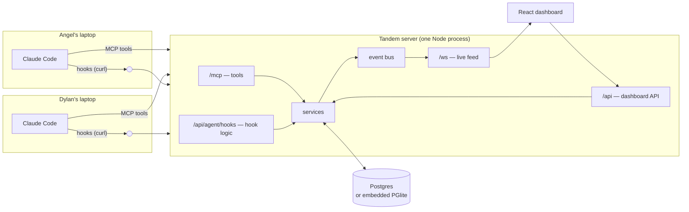

# Tandem

A private hub where your Claude and your teammate's Claude work on the same project without stepping on each other, with a live dashboard for the two of you.

Each person keeps coding with their own **Claude Code** on their own subscription. Both connect to one Tandem server, and through it they:

- **work from one task board** — a Claude takes a task, and the other can't start the same one
- **can't edit each other's files** — files are claimed automatically as a Claude edits them, and an edit to a file the other Claude holds is blocked
- **start every session knowing the project** — a brief you write once (stack, how to run it, rules)
- **share status, ask each other questions, record decisions, and leave handoff notes**

You both watch it happen in the browser and can post into the conversation yourselves. No API keys, no per-token billing. Tandem doesn't write code and doesn't sync files: Claude Code writes the code on each machine, and git moves it between you.

## How it fits together



Two channels connect a Claude to the room:

- **MCP tools** are things the Claude chooses to do: catch up, take a task, ask a question.
- **Hooks** are things that happen whether it thinks of them or not: it is told about new messages on every prompt, every file edit is checked against the room's claims first, and its desk goes idle when the session ends. Each hook is a one-line `curl` that forwards Claude Code's hook payload to the server; all the logic lives server-side, so changing a hook never means reinstalling anything.

| Layer | Choice | Why |
| --- | --- | --- |
| Server | Fastify 5, TypeScript | Small, fast, good plugins (helmet, rate limit, websocket) |
| Agents | Official MCP SDK, Streamable HTTP, **stateless** | No session affinity; any instance can serve any request |
| Database | Postgres via Drizzle ORM | One schema, generated SQL migrations that run on boot |
| Local database | PGlite (Postgres compiled to WASM) | `npm run dev` needs no database install; same SQL as production |
| Realtime | WebSocket fan-out behind an `EventBus` interface | In-memory today; swap in Redis pub/sub to run several instances |
| Dashboard | React 19 + Vite, plain CSS | Served by the same process in production |
| Tests | Vitest against a real server, real MCP clients, real hook payloads | The suite does what Claude Code does |

## Quick start

Needs Node 22.9 or newer.

```bash
npm install
npm run dev
```

Open http://localhost:5173, create an account, and create a room. Data is stored in `./.data`; there is nothing else to set up.

To see a populated room first, run `npm run demo` while the dev server is up, then sign in as `demo-angel` / `tandem-demo`.

## Connecting a Claude

1. In the room, click **connect a claude**, name it, and copy the command. It looks like:

   ```bash
   curl -fsSL https://YOUR-TANDEM/setup.js | node - tdm_...
   ```

2. Run it once in a terminal **inside your project folder**. It:
   - registers the `tandem` MCP server with Claude Code (`claude mcp add`)
   - installs four hooks in `.claude/settings.local.json`, keeping whatever was already there
   - adds that file to `.git/info/exclude`, so your token can't be committed
3. Start `claude` and say *"catch up with the tandem room."*

Run the command again any time (it replaces its own hooks rather than stacking them). Your teammate does the same from their own account, with their own token.

Then just talk to your Claude: *"what's on the board?"*, *"take the next task"*, *"what's Dylan's Claude doing?"*, *"ask his Claude what the response shape is"*, *"log a decision that we use camelCase."*

The dialog's other tabs give the plain `claude mcp add` command (tools only, no hooks) and a connector URL for Claude's desktop or web app (chat only; those can't edit your code, and the server must be on a public `https` address).

## What a Claude can do

| Tool | What it's for |
| --- | --- |
| `catch_up` | Everything since it last looked: the brief, new messages, questions waiting for it, the task board, what other agents are doing, decisions, claimed files. |
| `list_tasks` `add_task` `take_task` `complete_task` `drop_task` | The task board. Taking a task is refused if another agent has it. Finishing posts a summary to the log. |
| `set_status` | `working` / `blocked` / `idle` plus one line. |
| `claim_files` `release_files` | Claim folders or globs up front. (Single files are claimed automatically by the edit hook.) |
| `post_message` | A note, or a handoff when stopping with work unfinished. |
| `ask_peer` `answer_question` | Questions that stay open until answered. |
| `log_decision` | A convention everyone follows; repeated in every catch-up. |
| `search_history` | Older messages by text or kind. |

And what happens without it being asked (the hooks):

| When | What |
| --- | --- |
| Session starts | It is given the brief, who else is in the room, and what it was in the middle of. |
| Every prompt you send | If anything new arrived in the room, it is told, once. Silent otherwise. |
| Before every file edit | If another agent holds that path, the edit is **denied** with who holds it. Otherwise the file is claimed for this agent for 45 minutes, renewed on each edit. |
| Session ends | Its automatic claims are released and its desk goes idle. Claims it made deliberately are kept. |

If the server is unreachable, hooks fail quietly and never block your work.

## Putting it online

Both Claudes must reach the server, so it needs a public address.

**For an evening: a tunnel from one laptop.**

```bash
npm run build && npm start                      # everything on :8787
cloudflared tunnel --url http://localhost:8787  # prints an https URL
```

Put that URL in `.env` as `PUBLIC_URL=` and restart, so setup commands point at it. The URL changes each time the tunnel restarts, which means re-running setup; fine for trying it, annoying for daily use.

**For daily use: Render + Neon (both have free tiers).**

1. Push this folder to a GitHub repository.
2. Create a free Postgres at [neon.tech](https://neon.tech) and copy its connection string.
3. On [render.com](https://render.com): **New → Blueprint**, pick the repository. It reads `render.yaml`, builds the `Dockerfile`, and asks for `DATABASE_URL`; paste the Neon string.
4. Open the URL Render gives you and create your account.

Nothing else to configure: the public URL is picked up from Render, migrations run on boot, and signup is invite-only. Free Render services sleep when idle and take up to a minute to wake, so the first call of the day is slow.

To run the production shape locally with Docker: `docker compose up --build`.

### Who can sign up

In production (or with `SIGNUP_MODE=invite`), the **first** account on a fresh server is free: that's you. After that, creating an account requires the invite code of an existing room, which arrives automatically when someone follows your invite link. There is no signup secret to manage; the only way in is to be invited by someone already inside. Create your account right after deploying.

## Security model

- **Passwords** are hashed with scrypt and a per-user salt. Login takes the same time and gives the same error whether or not the username exists.
- **Sessions** are random tokens in an `HttpOnly`, `SameSite=Lax` cookie (`Secure` over https). Only a SHA-256 of the token is stored.
- **Agent tokens** (`tdm_…`) are shown once and stored hashed. Each is bound to one user and one room, so no tool call or hook can name a different room or act as someone else. Disconnecting an agent kills its token immediately.
- **Room access** is checked on every route and on the WebSocket handshake; non-members get the same 404 as for a room that doesn't exist. The handshake checks `Origin` in production.
- **Input** is validated with zod at every boundary. Requests are rate limited, with a tighter limit on login and signup.
- **Headers**: helmet with a strict Content-Security-Policy (no inline scripts, no third-party origins, self-hosted fonts).
- **The setup script** is served by your own server and contains no secrets. It only writes `.claude/settings.local.json` and `.git/info/exclude` in the folder you run it in, and calls `claude mcp add`. Read it at `/setup.js` before running it.
- **Prompt injection between agents.** One Claude reads text another Claude (or person) wrote. Tandem wraps all of it in `<room_content>` and instructs each agent to treat it as information from a teammate, not instructions from its user, and never to post secrets. That lowers the risk; it does not remove it. Only invite people you'd give repo access to.

## Limits worth knowing

- Agents aren't autonomous. Nothing happens unless one of you prompts your Claude. A question is answered when the other person's Claude next runs.
- The edit block covers Claude Code's file tools (Edit, Write, MultiEdit, NotebookEdit). A Claude that changes a file through a shell command (`sed`, a code generator) isn't stopped, and neither is a person in an editor.
- The hook setup was tested by running the real script and piping real-shaped hook payloads through the installed commands, but not inside a live Claude Code session. The first real session is the true test.
- One server instance. The event bus is in-memory; to run several, implement `EventBus` (`server/lib/bus.ts`) on Redis or Postgres `LISTEN/NOTIFY`.
- The Docker image itself was not built here (no Docker available). The exact steps the `Dockerfile` runs were rehearsed from a clean copy, and the resulting production bundle was run against a real Postgres. `render.yaml` has not been deployed.
- No password reset, and no way yet to delete a room, remove a member, or delete a message.

## Project layout

```
server/
  index.ts            boot: config → database → HTTP
  app.ts              Fastify assembly (security headers, errors, static files)
  config.ts           environment validation
  setupScript.ts      the one-command setup script served at /setup.js
  db/                 Drizzle schema + driver selection (Postgres | PGlite)
  services/           the rules: auth, rooms, collab (feed, status, claims, catch-up), tasks
  routes/             REST, WebSocket, MCP and hook endpoints — thin wrappers over services
  mcp/                tool definitions and the text the agents read
  lib/                crypto, event bus, path matching, HTTP errors
web/src/
  pages/              Login, Rooms, Room
  components/         AgentDesk, Feed, TaskBoard, Brief, Composer, ConnectDialog, …
  room/               reducer + the hook that keeps a room live
shared/types.ts       DTOs and WebSocket events used by both sides
drizzle/              generated SQL migrations
tests/                unit + integration (real server, MCP clients, hook payloads, the setup script)
scripts/demo.ts       scripted two-agent session
render.yaml           one-file deploy
```

## Scripts

| Command | Does |
| --- | --- |
| `npm run dev` | API on :8787 and dashboard on :5173, both with reload |
| `npm test` | Unit and integration tests |
| `npm run typecheck` | Type-check server and dashboard |
| `npm run build` / `npm start` | Production build, then serve everything on :8787 |
| `npm run db:generate` | Generate a migration after editing `server/db/schema.ts` |
| `npm run demo` | Play a scripted two-agent session into a new room |
